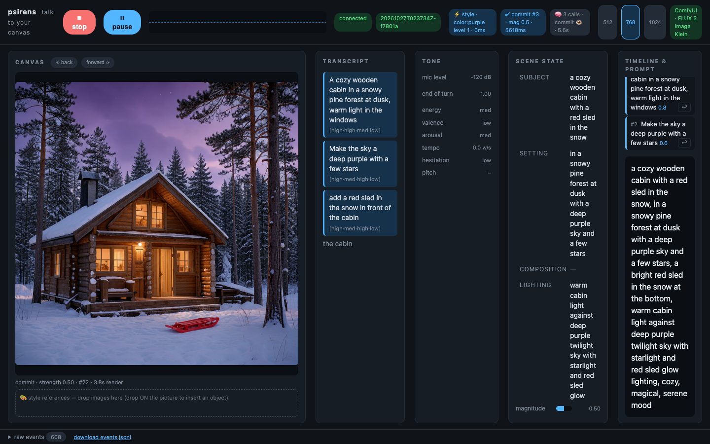
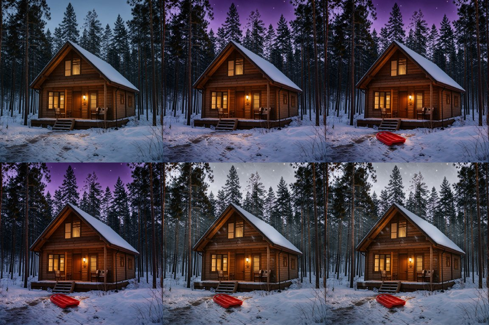
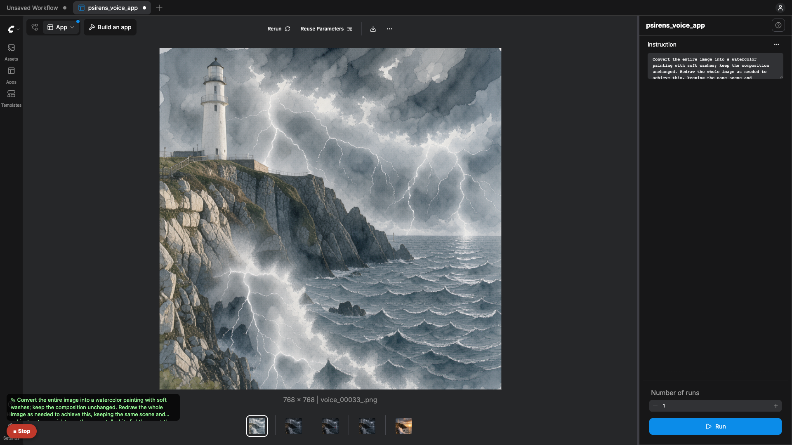
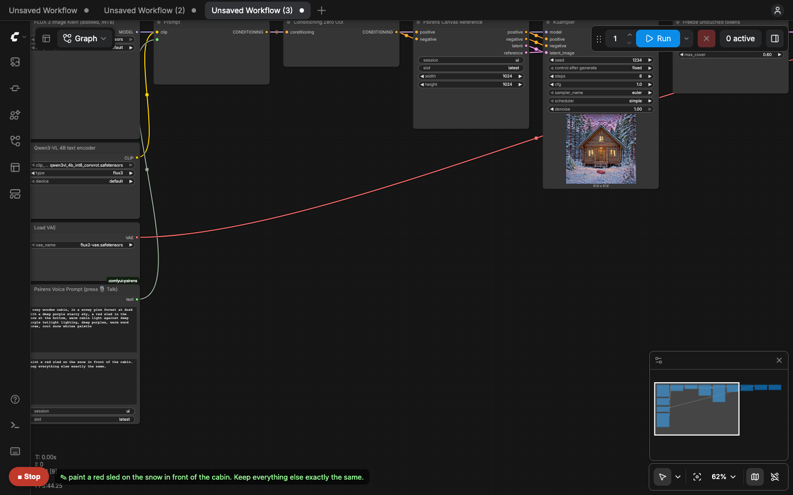

# Psirens: talk to your canvas

**Voice-steered, live image editing on FLUX 3 Image Klein, built on ComfyUI.**

You talk; the picture changes while you watch. "A cabin in a snowy forest at
dusk." The picture appears. "Make the sky purple." Only the sky changes.
"No, go back." The edit is undone instantly. There's no prompt box and no
Generate button: you steer by reacting to what you see.

**[Watch the demo video (1:42)](docs/psirens-demo.mp4)**

It runs natively in ComfyUI:

1. **The Psirens app, in ComfyUI App Mode.** Open
   `workflows/psirens_voice_app.app.json`, press **🎙 Talk** and speak. The
   picture appears, and every later sentence edits it. "No, go back" undoes
   the last edit exactly.
2. **`comfyui-psirens`**, the node pack behind it: a *Voice Prompt* node,
   the 🎙 Talk button (works on any graph with a Voice Prompt node), and
   nodes that keep long edit chains from drifting.
3. A standalone web UI (`http://localhost:8800`) with the voice
   internals on display (live transcript, tone meters, scene state, timeline).

Every model is open weights, and the whole stack runs on your own GPUs.



*Spoken: "A cozy wooden cabin in a snowy pine forest at dusk…", "Make the
sky a deep purple with a few stars", "Add a red sled in the snow in front of
the cabin". Each edit changes only what was named:*



## How it works

```
mic ─▶ speech-to-text ─▶ commit detector ─▶ scene editor (LLM) ─▶ renderer ─▶ Comfy SDK ─▶ ComfyUI
       (Nemotron,         (pauses, falling    (structured scene,    (lanes,      (Comfy API v2,  (FLUX 3 Image Klein
        streaming)         pitch, "um...",     minimal patches,      undo         comfy-api-     + Psirens nodes)
       + prosody           self-repair:        edit instruction)     keyframes)   proxy)
         (tone)            "blue, no, green")
```

- **Commit detection.** Psirens doesn't fire on every word. It waits until
  your sentence is actually finished: a pause, falling intonation, a
  complete thought. Hesitation ("umm…", rising pitch) means *hold*.
  Self-repairs are resolved before the LLM sees them: "make it blue, no,
  green" becomes "make it green".
- **Structured scene state.** The LLM never rewrites the whole prompt. It
  patches specific fields (subject, setting, lighting, palette, …) and
  writes one edit instruction, so nothing you didn't mention drifts. Every
  commit is a timeline entry: undo, redo and "go back" restore exact
  pixels instantly, with no re-render.
- **Edit-native rendering.** Only the first image is generated from
  scratch. Everything after that is a FLUX 3 Image Klein *edit* of the
  current canvas, run as a ComfyUI workflow (`workflows/`) through the
  **Comfy SDK** against ComfyUI's **Comfy API v2** (served by Comfy's
  `comfy-api-proxy`).
- **FLUX 3 prompt upsampling.** Short spoken edits ("purple sky") are
  expanded with BFL's FLUX 3 upsampler instructions. The expansion runs on
  the same vision LLM as the scene editor, which sees the current frame,
  so no second 9B model is needed.
- **Drift-free edit chains (the node pack).** Twenty edits into a session,
  an ordinary edit loop has round-tripped the canvas through the VAE twenty
  times and repainted every pixel twenty times. *Psirens Canvas Save/Load*
  keep the canvas as a **latent inside ComfyUI** and reference it
  directly, so there are no decode/encode round-trips. *Psirens Token
  Passthrough* copies every latent token whose change sits at the model's
  repaint-noise floor back **bit-exactly** from the reference. Regions the
  edit didn't touch stop aging, however long you talk.

### Proof: 12 edits of "keep everything exactly the same"

Same FLUX 3 Image Klein graph, same seed, 12 chained no-op edits starting
from the first frame. Left to right: start, a normal ComfyUI edit loop after
4 and 12 edits (save → load → VAE-encode → edit), and Psirens after 12.


| after 12 edits | normal loop | Psirens |
|---|---|---|
| pixels changed vs. start | 86% | 0.5% (first encode only; edits 2–12 are bit-identical) |
| PSNR vs. start | 17.1 dB | 38.7 dB |

## The node pack (`custom_nodes/comfyui-psirens`)

| Node | What it does |
|---|---|
| **Psirens Voice Prompt** | A prompt you can speak. The 🎙 Talk button fills it and queues the workflow. Outputs the full scene for the first image and the spoken edit afterwards. |
| **Psirens Canvas Reference** | Points an edit model at the current canvas latent if one exists. Otherwise it passes through and gives an empty latent, so one graph handles the first generation *and* every edit. |
| **Psirens Canvas Save / Load** | Keep a latent in ComfyUI between runs (per session and slot). |
| **Psirens Token Passthrough** | Freezes untouched tokens (noise-floor threshold, 3×3 smoothing, global-edit guard). |
| **Psirens Empty Latent Like**, **Canvas Reset** | Helpers. |

The **🎙 Talk** button (bottom-left in ComfyUI) streams your mic through
ComfyUI (`/psirens/ws`) to the Psirens voice service. On every finished
thought it writes the scene and the edit into each *Psirens Voice Prompt*
node and queues the graph. Load `workflows/psirens_voice_edit_api.json`
(FLUX 3 Image Klein, voice-steered, drift-free) and talk.





## Workflows

| File | Used for |
|---|---|
| `workflows/psirens_root_api.json` | First image: FLUX 3 Image Klein text-to-image, latent stored for editing |
| `workflows/psirens_edit_latent_api.json` | Edit referencing the stored canvas latent + token passthrough |
| `workflows/psirens_edit_pixels_api.json` | Edit from an uploaded frame (after undo past eviction, resolution change) |
| `workflows/psirens_voice_app.app.json` | **The app**: ComfyUI App Mode, voice-steered, drift-free, with undo |
| `workflows/psirens_voice_edit.json` | The same graph for the node editor (🎙 Talk works here too) |

All use the official FLUX 3 Image Klein distilled checkpoint (INT8),
Qwen3-VL-4B text encoder and FLUX.2 VAE: euler / simple, cfg 1, 8 steps
(6 in the voice app, 4 for provisional previews).

## Run it

Requirements: Linux, Docker with the NVIDIA container toolkit, and **one
24 GB NVIDIA GPU**. The whole stack (FLUX 3 Image Klein + editor LLM +
speech-to-text) was developed on a single RTX 3090. With two cards, set
`COMFY_GPU` / `VOICE_GPU` in `.env` to split them.

```bash
git clone <this repo> psirens-comfy && cd psirens-comfy
cp .env.example .env              # GPU ids, editor model
# FLUX 3 Image Klein is gated: accept it at
# https://huggingface.co/black-forest-labs/flux-3-image-klein-comfy
echo "HF_TOKEN=hf_..." >> .env
docker compose --profile tools run --rm downloader   # ~22 GB of models
docker compose up -d --build
```

- App: <http://localhost:8800>. Press the mic and talk. Browsers only
  allow the mic on `localhost` or HTTPS. For a remote GPU box, use
  `ssh -L 8800:127.0.0.1:8800 -L 8288:127.0.0.1:8288 <host>`.
- ComfyUI: <http://localhost:8288>. Drop in
  `workflows/psirens_voice_edit_api.json` and use 🎙 Talk.

Services: `comfyui` (ComfyUI v0.42.5 + node pack), `comfy-api` (Comfy API v2
proxy), `vllm` (scene editor LLM), `orchestrator` (voice service + app UI),
`renderer` (Comfy SDK client). Stop everything with `docker compose down`.

## Models (all open weights)

| Role | Model |
|---|---|
| Image generation and editing | FLUX 3 Image Klein (distilled, INT8) + Qwen3-VL-4B text encoder + FLUX.2 VAE |
| Scene editor, prompt upsampler | Qwen3.5-4B (AWQ 4-bit) via vLLM |
| Speech-to-text | NVIDIA Nemotron Speech Streaming 0.6B + Parakeet realtime EOU 120M |
| Tone of voice | audEERING wav2vec2 emotion (arousal/valence) |

## License

MIT (see `LICENSE`). The models have their own licenses.
